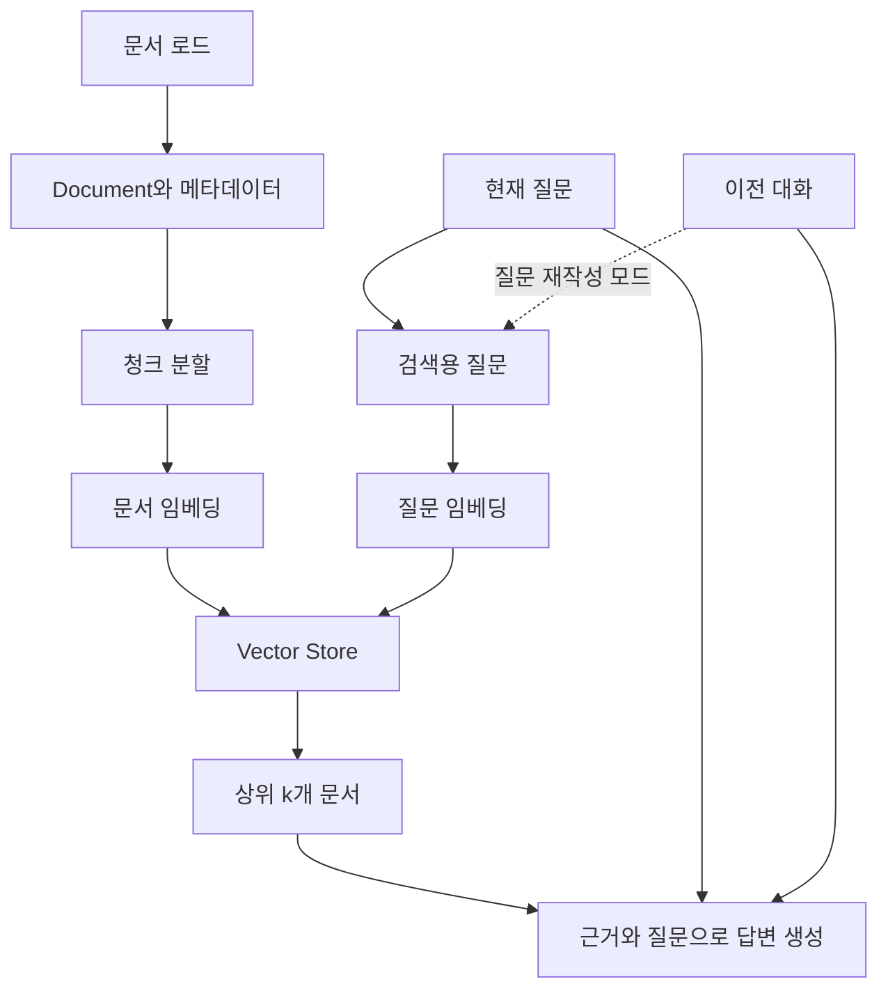

# RAG: 문서 검색에서 후속 질문까지

## 1. 검색과 생성을 분리한다

RAG는 질문에 관련된 자료를 찾아 모델 입력에 함께 넣는다. 문서를 모델 파라미터에 학습시키는 방식이 아니다.
검색이 틀리면 유창한 답변도 근거가 틀릴 수 있다. 먼저 검색 결과를 보고 생성 품질을 본다.



문서를 준비하는 인덱싱 단계와 질문별 검색·생성 단계를 구분한다.
예제는 실행마다 새로 인덱싱하므로 임베딩 비용이 반복된다.

## 2. Document와 로딩

`Document`는 `page_content`와 `metadata`를 가진다. 예제는 UTF-8 텍스트를 읽고 source에 파일명을 붙인다.
파일 읽기와 검색 단위로 분할하기는 별도 작업이다.
PDF·웹·DB에는 각각 로더가 필요하다. PDF는 페이지·읽는 순서·표를 확인하고 스캔 문서는 OCR을 고려한다.
이 저장소에는 PDF 로더 구현을 포함하지 않았으므로 PDF RAG를 완료했다고 기록하지 않는다.

## 3. 청크 분할

`RecursiveCharacterTextSplitter(chunk_size=300, chunk_overlap=60)`을 사용한다.
기본 길이 단위는 문자다. 토큰 300개가 아니다.
구분자로 나누므로 모든 청크가 정확히 300자이거나 정확히 60자씩 겹치는 것도 아니다.
작은 청크는 세부 정보를 좁혀 찾기 좋지만 문맥이 끊기고, 큰 청크는 문맥과 함께 잡음·입력량도 늘어날 수 있다.
`add_start_index=True`로 원문 시작 위치를 기록한다. 숫자를 조절하기 전에 실제 청크를 확인한다.

## 4. 임베딩과 벡터 저장소

임베딩 모델은 텍스트를 벡터로 바꾸고 저장소는 벡터와 원문을 보관·비교한다. 답변 모델과 역할이 다르다.
문서와 질문은 호환되는 같은 임베딩 공간을 사용해야 한다. 모델·차원을 바꾸면 문서도 다시 임베딩한다.
`InMemoryVectorStore`는 프로세스를 종료하면 사라진다. 영속 저장소 교체는 확장 실습이다.
저장소 교체만으로 검색 품질이 자동으로 개선되는 것은 아니다.

## 5. 검색 API와 점수

```python
documents = store.similarity_search(question, k=2)
pairs = store.similarity_search_with_score(question, k=2)
retriever = store.as_retriever(search_kwargs={"k": 2})
documents = retriever.invoke(question)
```

각각 문서, 문서·점수 쌍, Runnable 인터페이스로 조회한 문서를 반환한다.
이 예제 저장소의 점수는 코사인 유사도다. 확률이나 정답 신뢰도가 아니다.
다른 저장소는 낮을수록 가까운 거리 값을 반환하기도 하므로 정의를 확인한다.
`k`는 반환 개수다. 무관한 문서도 가까운 순서로 반환될 수 있다.
늘리면 정답이 포함될 가능성과 함께 잡음·토큰량도 늘어난다. 점수 기준을 무작정 정하지 말고 실제 질문의 분포를 관찰한다.
메타데이터 필터는 문서·날짜 등의 범위를 제한한다. 권한 제한은 서버에서 적용해야 한다.
MMR(다양성 고려), 키워드와 의미를 결합하는 하이브리드 검색은 다음 실험이며 이번 코드에는 구현하지 않았다.

## 6. 기본 RAG

검색 결과에 `[1]`, `[2]`와 파일명·시작 위치를 붙여 모델에 전달한다.
문서 밖 질문은 모른다고 답하고 근거 번호를 쓰도록 지시하지만 이것만으로 환각이 제거되지는 않는다.
문서의 내용은 명령이 아닌 자료다. 문서 안의 지시가 사용자 요청이나 시스템 지침을 바꿔서는 안 된다.
실제 서비스에서는 접근 제어와 인용 근거 검사도 설계한다.

## 7. History-aware RAG

멀티턴 RAG도 답변에는 history를 쓸 수 있다. 다만 검색에 현재 질문만 쓰면 후속 질문의 주어를 놓칠 수 있다.

```text
첫 질문: 예정 시트에서 직접 수정해도 돼?
후속 질문: 그럼 어디서 수정해야 해?
재작성 예: 예정 시트 내용은 어디서 수정해야 하는가?
```

예제는 첫 질문은 그대로 검색하고 이전 대화가 있을 때만 재작성 모델을 한 번 더 호출한다.
재작성 질문으로 검색하고 최종 답변에는 원래 질문과 대화를 준다.
위 재작성은 예상 예시다. 실제 출력이 대화에 없던 주어를 추가하지 않았는지 확인한다.
`--search-only`에서는 재작성도 하지 않는다.

## 8. Agentic RAG와 차이

| 항목 | 고정 RAG | History-aware RAG | Agentic RAG |
| --- | --- | --- | --- |
| 검색 여부·순서 | 개발자가 고정 | 개발자가 고정 | 모델이 선택 가능 |
| 후속 질문 | 별도 설계 필요 | 대화로 질문 재작성 | 설계에 따라 가능 |
| 추가 검색 | 코드에 정한 경우 | 코드에 정한 경우 | 판단과 실행 제한 안에서 가능 |
| 비용·시간 | 비교적 예측 쉬움 | 재작성 호출 추가 | 선택·반복에 따라 달라짐 |

Agentic RAG가 반드시 더 나은 선택은 아니다. 단순 문서 질의에는 고정 흐름이 관리하기 쉬울 수 있다.
이 저장소의 agent.py는 곱셈 도구만 쓴다. 검색 도구를 연결한 Agentic RAG 구현과 구분한다.

## 공식 참고

- [검색과 RAG](https://docs.langchain.com/oss/python/deepagents/retrieval)
- [문자 기반 분할](https://docs.langchain.com/oss/python/integrations/splitters/recursive_text_splitter)
- [Google 임베딩과 검색](https://docs.langchain.com/oss/python/integrations/embeddings/google_generative_ai)
